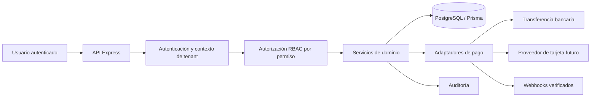
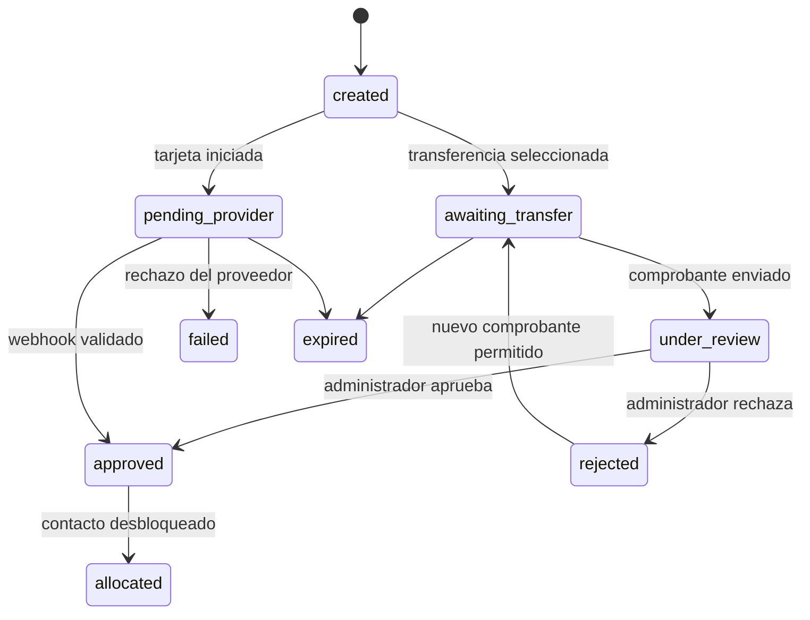

# Plan de desarrollo: panel administrativo, pagos y arquitectura multitenant

## 1. Propósito

Construir un panel administrativo seguro para operar ArtoCamello. El panel permitirá consultar, revisar y aprobar o rechazar pagos realizados por transferencia bancaria; gestionar clientes, profesionales y usuarios administrativos; y dejar una base de pagos extensible para habilitar tarjeta con un proveedor certificado posteriormente.

La plataforma se preparará para múltiples tenants. Un tenant representa una organización o instancia operativa de la plataforma, con datos, usuarios administrativos, configuración de cobro y reglas aisladas de los demás tenants.

## 2. Diagnóstico del proyecto actual

| Área | Estado actual | Implicación para el plan |
| --- | --- | --- |
| Frontend | React 18, TypeScript, Vite, React Router y componentes shadcn/Radix. | Se puede añadir un área `/admin` y componentes reutilizables sin cambiar la base tecnológica. |
| Backend | Express con Prisma y PostgreSQL. | Prisma será el origen de las migraciones y Express expondrá una API administrativa separada. |
| Usuarios | `User.role` sólo admite `client`, `pro` y `guest`. | No hay administrador, permisos granulares ni pertenencia a organización. |
| Autorización | JWT con rol incluido y middleware que únicamente valida el token. | Debe evolucionar a autorización en servidor por tenant y permiso; el cliente no será fuente de autorización. |
| Pagos | `LeadPurchase` conserva el pago del lead y los campos específicos de PayPhone. El flujo actual redirige a PayPhone y confirma desde el frontend. | No existe transferencia bancaria ni una entidad de pago reutilizable. Los campos específicos del proveedor deben migrarse a un modelo de pagos. |
| Panel | Existe un dashboard para profesionales, pero no un panel interno. | Se requiere un layout, rutas y API exclusivos para administradores. |
| Aislamiento de datos | No existen `tenantId`, organizaciones ni filtros de alcance. | Cada consulta nueva y cada dato de negocio debe quedar ligado a un tenant. |

Hallazgos que deben corregirse durante la implementación:

- El límite documentado para un lead es cuatro profesionales, mientras el backend aplica seis; se debe definir una única configuración por tenant y usarla de forma consistente.
- La confirmación del pago actual se inicia desde el navegador. La integración futura debe aceptar webhooks verificados del proveedor y hacer idempotente cada transición de estado.
- Los montos se almacenan como `Float`. Los nuevos pagos deben guardar importe monetario como `Decimal(12,2)` y código ISO de moneda.
- No hay trazabilidad de acciones administrativas ni control de permisos por operación.

## 3. Decisiones de alcance

### Incluido en la primera entrega

- Administración de usuarios finales: consulta, filtros, detalle, activación o suspensión y verificación de profesionales.
- Administración de usuarios internos, invitaciones, roles y permisos.
- Bandeja de pagos por transferencia, revisión de comprobantes, aprobación, rechazo y conciliación manual.
- Historial de pagos de leads, con filtros y exportación CSV.
- Auditoría de las acciones sensibles.
- Fundaciones multitenant y preparación del contrato de pagos para tarjeta.

### Fuera de la primera entrega

- Captura de tarjetas, almacenamiento de tarjetas, cuotas, reembolsos automáticos y liquidaciones a profesionales.
- Facturación electrónica SRI.
- Un portal autoservicio para que un tenant cree su propia organización.
- Cambiar los pagos de trabajos entre cliente y profesional: este plan cubre el cobro de ArtoCamello por desbloquear un contacto.

## 4. Arquitectura objetivo



### Aislamiento multitenant

Se usará un modelo de **base de datos compartida con `tenantId` por fila**. Es apropiado para el estado actual del proyecto, reduce coste operativo y permite separar lógica y datos desde el inicio. Todo recurso de negocio y administrativo incorporará `tenantId`; todas las lecturas y mutaciones internas filtrarán por el tenant activo.

El tenant se resolverá inicialmente desde el subdominio o dominio configurado y se fijará en el JWT o la sesión después de validarse contra la base. El backend volverá a validar que la membresía del usuario pertenece al tenant solicitado. Un `platform_owner` puede tener acceso global sólo mediante una ruta y permiso explícitos de plataforma; no se usará `tenantId` recibido en el cuerpo de una petición como mecanismo de autorización.

Para evitar omisiones, los repositorios o servicios recibirán un `TenantContext` obligatorio (`tenantId`, `actorId`, permisos) y Prisma se encapsulará para que las consultas administrativas no se escriban directamente en handlers.

## 5. Modelo de datos propuesto

### Tenancy y acceso

| Entidad | Campos principales | Finalidad |
| --- | --- | --- |
| `Tenant` | `id`, `slug`, `name`, `status`, `settings`, `createdAt` | Organización o instancia operativa. `slug` será único. |
| `TenantDomain` | `id`, `tenantId`, `hostname`, `isPrimary` | Resuelve el tenant por dominio o subdominio. |
| `TenantMembership` | `id`, `tenantId`, `userId`, `roleId`, `status`, `invitedAt`, `acceptedAt` | Vincula un usuario administrativo con un tenant. |
| `AdminRole` | `id`, `tenantId` opcional, `code`, `name`, `isSystem` | Rol reutilizable de plataforma o específico de tenant. |
| `Permission` | `id`, `code`, `resource`, `action`, `description` | Catálogo inmutable de permisos. |
| `RolePermission` | `roleId`, `permissionId` | Relación entre rol y permisos. |
| `AuditLog` | `id`, `tenantId`, `actorId`, `action`, `entityType`, `entityId`, `before`, `after`, `ip`, `createdAt` | Evidencia de acciones sensibles. |

`User` conservará los roles de producto (`client`, `pro`, `guest`) mientras que el acceso administrativo se decidirá por `TenantMembership`. Así una persona puede ser cliente o profesional y tener una membresía administrativa sin que los conceptos se mezclen.

### Pagos

| Entidad | Campos principales | Finalidad |
| --- | --- | --- |
| `Payment` | `id`, `tenantId`, `payerUserId`, `amount Decimal`, `currency`, `method`, `status`, `reference`, `provider`, `providerPaymentId`, `metadata`, `createdAt`, `confirmedAt`, `expiresAt` | Registro financiero común para cualquier método. |
| `PaymentAllocation` | `id`, `tenantId`, `paymentId`, `subjectType`, `subjectId`, `amount` | Imputa un pago a una compra de lead u otro concepto futuro. |
| `TransferSubmission` | `id`, `paymentId`, `bankName`, `accountLast4`, `transferReference`, `transferredAt`, `proofFileId`, `submittedBy`, `reviewedBy`, `reviewedAt`, `reviewNote` | Datos y revisión de una transferencia. |
| `PaymentEvent` | `id`, `tenantId`, `paymentId`, `type`, `source`, `payload`, `idempotencyKey`, `createdAt` | Eventos de proveedor, webhook y acciones manuales para trazabilidad e idempotencia. |
| `StoredFile` | `id`, `tenantId`, `storageKey`, `mimeType`, `size`, `checksum`, `createdBy`, `createdAt` | Metadatos de comprobantes, sin guardar binarios en PostgreSQL. |

`LeadPurchase` se conservará como la regla de negocio que desbloquea un contacto, pero pasará a tener `tenantId` y una relación con `PaymentAllocation`. Los campos `payphoneTransactionId` y `payphoneClientTxId` se migrarán progresivamente a `Payment.providerPaymentId`, `Payment.reference` y `PaymentEvent`; no se eliminarán hasta comprobar la migración de datos y compatibilidad histórica.

### Estados de pago



El desbloqueo del contacto sólo ocurrirá al aprobar y asignar el pago dentro de una transacción de base de datos. El contador de compras se actualizará mediante una operación condicional que verifique el límite configurado, para evitar que dos confirmaciones simultáneas superen el cupo.

## 6. Roles y permisos iniciales

Los permisos serán códigos estables, por ejemplo `payments.review`, `users.read` o `admins.invite`. La interfaz puede agruparlos por módulo, pero el backend validará el código puntual.

| Rol | Propósito | Permisos principales |
| --- | --- | --- |
| `platform_owner` | Operación global excepcional. | Gestión de tenants, todos los permisos de cada tenant, auditoría global. |
| `tenant_owner` | Responsable de una organización. | Usuarios, administradores, configuración, pagos y reportes de su tenant. |
| `operations_admin` | Gestión diaria de usuarios y leads. | Lectura y edición de clientes/profesionales, verificación, solicitudes y reportes. |
| `payments_reviewer` | Conciliación financiera. | Ver y revisar transferencias, exportar pagos y consultar auditoría de pagos. |
| `support_agent` | Atención de primer nivel. | Consulta de usuarios, solicitudes y pagos; sin aprobar cobros ni modificar permisos. |
| `auditor` | Revisión de solo lectura. | Lectura de pagos, usuarios, configuración y logs de auditoría. |

Reglas obligatorias:

- Un administrador no puede cambiar su propio rol ni desactivarse.
- La aprobación o rechazo de una transferencia requiere `payments.review`; toda decisión registra actor, fecha, nota y estado anterior.
- Una transferencia no puede ser aprobada dos veces. Las acciones de aprobación y el procesamiento de webhooks serán idempotentes.
- Las cuentas administrativas requerirán correo verificado y, antes de producción, MFA para roles con acceso a pagos y permisos.

## 7. Experiencia del panel

Host base: `https://admin.artocamello.com`. Se protegerá tanto en React como en el backend; el guard del frontend mejora la experiencia, pero no concede acceso. El sitio público no servirá rutas administrativas.

| Módulo | Ruta sugerida | Contenido y acciones |
| --- | --- | --- |
| Inicio | `https://admin.artocamello.com/` | Indicadores de transferencias pendientes, pagos aprobados, usuarios nuevos, profesionales por verificar y actividad reciente. |
| Transferencias | `https://admin.artocamello.com/payments/transfers` | Tabla paginada, filtros por estado, fecha, monto, banco y referencia; detalle, comprobante privado, aprobar, rechazar y exportar. |
| Todos los pagos | `https://admin.artocamello.com/payments` | Historial unificado de PayPhone existente, transferencia y futura tarjeta; filtros, detalle de eventos y asignaciones. |
| Clientes | `https://admin.artocamello.com/users/clients` | Búsqueda, estado, solicitudes, perfil y suspensión o reactivación con motivo. |
| Profesionales | `https://admin.artocamello.com/users/professionals` | Perfil, documentos, verificación, leads adquiridos, pagos y suspensión o reactivación. |
| Administradores | `https://admin.artocamello.com/access/admins` | Lista de membresías, invitaciones, cambio de rol, revocación y estado. |
| Roles y permisos | `https://admin.artocamello.com/access/roles` | Roles del tenant, matriz de permisos y roles del sistema de solo lectura. |
| Configuración | `https://admin.artocamello.com/settings` | Datos del tenant, cuentas bancarias receptoras, límite de compradores por lead, comisión y configuración de proveedor. |
| Auditoría | `https://admin.artocamello.com/audit` | Filtros por actor, recurso, acción y fecha; detalle de cambios sin exponer secretos. |

La bandeja de transferencias mostrará como mínimo: identificador, profesional pagador, lead, monto y moneda, referencia declarada, banco, fecha de transferencia, fecha de envío, estado, revisor y enlace temporal al comprobante. Antes de aprobar, mostrará la cuenta de destino configurada y advertirá duplicados de referencia, monto, pagador o comprobante.

## 8. API propuesta

Todos estos endpoints exigen token válido, contexto de tenant y permiso. Usarán paginación cursor o `page`/`pageSize` con máximo definido, filtros validados y respuestas sin campos sensibles.

| Método y ruta | Permiso | Función |
| --- | --- | --- |
| `GET /api/admin/dashboard` | `dashboard.read` | Métricas y alertas del tenant. |
| `GET /api/admin/payments` | `payments.read` | Pagos unificados paginados. |
| `GET /api/admin/payments/:id` | `payments.read` | Detalle, eventos y asignaciones. |
| `GET /api/admin/payments/transfers` | `payments.read` | Transferencias con filtros. |
| `POST /api/admin/payments/transfers/:id/approve` | `payments.review` | Aprueba, asigna y desbloquea el lead en una transacción. |
| `POST /api/admin/payments/transfers/:id/reject` | `payments.review` | Rechaza con motivo, sin eliminar el comprobante. |
| `GET /api/admin/users` | `users.read` | Clientes y profesionales paginados. |
| `PATCH /api/admin/users/:id/status` | `users.manage` | Suspende o reactiva con motivo auditado. |
| `POST /api/admin/professionals/:id/verify` | `professionals.verify` | Verifica o revoca verificación. |
| `GET /api/admin/memberships` | `admins.read` | Administradores del tenant. |
| `POST /api/admin/invitations` | `admins.invite` | Invita un administrador con rol predefinido. |
| `PATCH /api/admin/memberships/:id` | `admins.manage` | Cambia rol o estado con protecciones. |
| `GET /api/admin/roles` | `roles.read` | Lista roles y permisos. |
| `PUT /api/admin/roles/:id/permissions` | `roles.manage` | Actualiza matriz de permisos. |
| `GET /api/admin/audit-logs` | `audit.read` | Auditoría filtrable. |

Para el profesional se añadirán endpoints independientes para transferencias:

- `POST /api/payments/transfer-intents`: crea un `Payment` para un lead, devuelve instrucciones bancarias del tenant y una referencia única.
- `POST /api/payments/:id/transfer-proof`: valida y adjunta el comprobante; mueve el pago a `under_review`.
- `GET /api/payments/:id`: permite al pagador consultar únicamente su propio pago y estado.

## 9. Preparación para pagos con tarjeta

Se definirá una interfaz de adaptador, sin almacenar PAN, CVV ni datos de tarjeta:

```ts
interface PaymentProvider {
  createIntent(input: CreatePaymentIntent): Promise<ProviderIntent>;
  verifyWebhook(input: WebhookRequest): Promise<VerifiedPaymentEvent>;
  getPayment(reference: string): Promise<ProviderPaymentStatus>;
}
```

`TransferProvider` implementará la creación de instrucciones y el flujo manual. Un futuro `CardProvider` implementará la creación de una sesión de checkout alojado o campos tokenizados del proveedor. El navegador recibirá sólo una URL o token efímero del proveedor; ArtoCamello nunca procesará ni guardará números de tarjeta.

Requisitos antes de activar tarjeta:

- Seleccionar un proveedor disponible para Ecuador que soporte USD, webhooks firmados, conciliación y el modelo comercial de ArtoCamello.
- Configurar secretos fuera del repositorio y separados por ambiente y tenant cuando corresponda.
- Verificar firma, fecha y unicidad de cada webhook; registrar el evento antes de procesarlo.
- Implementar claves de idempotencia para crear intenciones y una tarea de expiración de pagos pendientes.
- Ejecutar pruebas sandbox, casos de pago aprobado, rechazado, webhook repetido y retorno del navegador sin webhook.

## 10. Fases de ejecución

### Fase 0 — decisiones y línea base

1. Confirmar la definición de tenant: si cada marketplace es un tenant o si el primer tenant será únicamente ArtoCamello.
2. Definir el límite de profesionales por lead como configuración del tenant y resolver el valor inicial (la documentación dice 4 y el backend actual usa 6).
3. Definir cuentas bancarias, monedas, plazo de expiración y responsables de conciliación.
4. Añadir entorno local reproducible, datos semilla y una cuenta `platform_owner` protegida para desarrollo.
5. Inventariar los `LeadPurchase` existentes para preparar su migración sin perder historial.

**Criterio de salida:** decisiones documentadas, migración revisada en una copia de base de datos y parámetros por ambiente definidos.

### Fase 1 — fundación multitenant y RBAC

1. Crear modelos Prisma de `Tenant`, dominios, membresías, roles, permisos y auditoría.
2. Crear el tenant inicial ArtoCamello, migrar usuarios y datos existentes a él, y añadir `tenantId` a entidades de negocio.
3. Crear migración con índices compuestos que incluyan `tenantId` para listados frecuentes y restricciones únicas por tenant.
4. Extender JWT y middleware para construir `TenantContext`, resolver membresía activa y validar permisos en el servidor.
5. Añadir guard del host administrativo, layout y navegación condicionada por permisos.
6. Registrar en `AuditLog` cambios de membresías, roles, usuarios, pagos y configuración.

**Criterio de salida:** ningún usuario de un tenant puede leer o mutar recursos de otro tenant, y el acceso administrativo se comprueba con pruebas de integración de autorización.

### Fase 2 — núcleo de pagos y migración de PayPhone

1. Crear `Payment`, `PaymentAllocation`, `PaymentEvent`, `StoredFile` y `TransferSubmission` con estados, índices y restricciones.
2. Migrar los datos existentes de `LeadPurchase` a pagos históricos, conservando referencias PayPhone y fecha de confirmación.
3. Extraer el flujo PayPhone actual a un adaptador que cree `Payment` y eventos, manteniendo compatibilidad temporal con el frontend profesional.
4. Encapsular la aprobación y asignación del pago en un servicio transaccional e idempotente que desbloquee el lead una sola vez.
5. Corregir el control concurrente del cupo de leads y usar el límite configurado del tenant.
6. Crear acceso temporal firmado para comprobar comprobantes; validar tipo, tamaño, checksum y escanear archivos antes de ponerlos a disposición de administradores.

**Criterio de salida:** pagos históricos aparecen en el nuevo historial y un pago no puede desbloquear más de un contacto ni incrementar dos veces el contador de compras.

### Fase 3 — transferencias para profesionales

1. Añadir selector de método de pago en la compra de lead.
2. Mostrar instrucciones bancarias del tenant y generar una referencia única para el pago.
3. Crear formulario de envío de comprobante con datos mínimos: banco, últimos cuatro dígitos de cuenta origen opcionales, referencia, fecha, monto y archivo.
4. Mostrar al profesional el estado `awaiting_transfer`, `under_review`, `approved`, `rejected` o `expired`, junto con el motivo de rechazo cuando exista.
5. Aplicar límites de tamaño y tasa, permitir reenvío tras rechazo y conservar la evidencia previa.

**Criterio de salida:** un profesional puede enviar una transferencia sin ver datos del contacto; el contacto se desbloquea sólo después de aprobación administrativa.

### Fase 4 — panel administrativo operativo

1. Construir dashboard y bandeja de transferencias con filtros, paginación, exportación y vista de detalle.
2. Implementar aprobar y rechazar con diálogo de confirmación, motivo obligatorio para rechazo y detección de posibles duplicados.
3. Construir gestión de clientes y profesionales, verificación de profesionales y cambios de estado auditados.
4. Construir administración de membresías, invitaciones, roles y permisos con reglas que impidan elevación de privilegios.
5. Añadir historial unificado de pagos, auditoría y configuración del tenant.

**Criterio de salida:** un `payments_reviewer` puede conciliar transferencias de su tenant y un `support_agent` no puede aprobarlas ni editar roles.

### Fase 5 — endurecimiento y tarjeta

1. Implementar el adaptador de tarjeta elegido con checkout alojado, webhooks firmados e idempotencia.
2. Añadir MFA para perfiles administrativos sensibles, recuperación segura de acceso y revocación de sesiones al cambiar privilegios.
3. Realizar pruebas de carga de listados, seguridad de autorización por tenant, revisión de auditoría y recuperación ante fallos de webhook.
4. Preparar monitorización: ratio de transferencias rechazadas, pagos pendientes vencidos, webhooks fallidos y tiempos de conciliación.

**Criterio de salida:** tarjeta se puede habilitar por tenant mediante configuración, sin modificar el flujo de aprobación o asignación de pagos.

## 11. Migración y compatibilidad

La migración se ejecutará en pasos reversibles y observables:

1. Crear el tenant inicial y tablas nuevas sin retirar campos existentes.
2. Poblar `tenantId` en lotes para todos los datos actuales y añadir restricciones `NOT NULL` después de validarlos.
3. Crear pagos históricos desde `LeadPurchase.status = paid`, marcándolos como importados y preservando IDs externos de PayPhone.
4. Activar lectura desde la nueva entidad `Payment` detrás de una bandera de funcionalidad y comparar resultados con el historial anterior.
5. Pasar la creación de nuevos pagos al servicio nuevo.
6. Retirar campos PayPhone heredados sólo después de un periodo acordado de doble lectura y de tener respaldo verificado.

No se deben exponer contraseñas, secretos de proveedores, tokens completos, datos bancarios completos ni comprobantes fuera de usuarios autorizados. Los datos de transferencia y auditoría seguirán la política de retención que defina el negocio.

## 12. Pruebas y criterios de calidad

| Capa | Casos mínimos |
| --- | --- |
| Dominio | Transiciones de estado válidas, idempotencia, asignación única, expiración y límite concurrente de compradores. |
| API | Aislamiento por tenant, permisos por endpoint, pertenencia del pagador, paginación, filtros y validación de archivos. |
| Integración de pago | Transferencia aprobada/rechazada/reintentada; PayPhone aprobado/fallido; webhook inválido o repetido; tarjeta sandbox futura. |
| Frontend | Rutas y acciones ocultas o bloqueadas por permiso, estados de carga/error, comprobante inaccesible para otros tenants. |
| Seguridad | Pruebas de IDOR, escalación de privilegios, cambio de tenant en URL/cuerpo/token, CSRF según método de sesión y rate limiting. |
| Migración | Conteo y montos conciliados entre compras históricas y pagos importados, con muestreo de referencias de PayPhone. |

Métricas de aceptación para producción:

- 100% de aprobaciones y rechazos generan un evento de auditoría con actor y fecha.
- 0 desbloqueos de contacto desde una transferencia pendiente, rechazada o vencida.
- 0 consultas administrativas que devuelvan registros de otro tenant en las pruebas de autorización.
- Los eventos repetidos de proveedor o las solicitudes repetidas de aprobación no alteran montos, cupos ni contactos más de una vez.

## 13. Riesgos y mitigaciones

| Riesgo | Mitigación |
| --- | --- |
| Comprobante falso o reutilizado | Revisión humana, referencia única, detección de duplicados, checksum, evidencia preservada y auditoría. |
| Fuga entre tenants | `TenantContext` obligatorio, filtros de servidor, índices/constraints por tenant y pruebas de aislamiento. |
| Doble aprobación o webhook repetido | Estados controlados, claves de idempotencia, transacciones y eventos únicos. |
| Manejo inseguro de tarjeta | Checkout/tokenización del proveedor; no recibir ni almacenar PAN o CVV. |
| Migración incompleta | Ejecución por etapas, conciliación de conteos/montos y doble lectura temporal. |
| Administrador con privilegios excesivos | RBAC por permiso, roles mínimos, MFA, revocación de sesión y auditoría. |

## 14. Entregables

1. Migraciones Prisma y datos semilla del tenant inicial, roles y permisos.
2. Middleware de contexto de tenant y autorización por permiso, acompañado de pruebas de integración.
3. Servicio de pagos genérico, adaptador de transferencia y adaptación de PayPhone.
4. Flujo profesional para transferencia y carga segura de comprobantes.
5. Panel en el subdominio administrativo con módulos de transferencias, pagos, usuarios, acceso, configuración y auditoría.
6. Documento de operación para conciliadores: criterios de aprobación/rechazo, manejo de duplicados, incidentes y tiempos de respuesta.
7. Especificación y configuración del adaptador de tarjeta, lista para conectar al proveedor seleccionado.

## 15. Estado de ejecución local (1 de octubre de 2026)

Las migraciones, el API administrativo, el flujo de transferencias, el panel y la integración de tarjeta desactivada por defecto están implementados en el árbol de trabajo actual. El formulario de comprobante ya registra el monto declarado; la vista de revisión lo muestra y el API bloquea la aprobación si difiere del monto esperado. Los comprobantes anteriores conservan el monto declarado vacío y requieren cotejo manual.

El flujo PayPhone reserva una única intención ante solicitudes simultáneas, solo inicia pagos para solicitudes abiertas y acepta confirmaciones tardías de una intención anterior tras un reintento. Las oportunidades con pagos vencidos vuelven a aparecer para el profesional. Un segundo cobro confirmado sin asignación queda señalado para resolución manual en el panel.
La creación de solicitudes está limitada en el API a usuarios con rol `client`.

En la base local se aplicaron las ocho migraciones disponibles. La compilación de servidor y frontend, la comprobación de tipos del frontend y las tres pruebas automatizadas pasaron. La conciliación local reportó cero compras pagadas y cero pagos asignados, sin diferencias; esto no valida una migración con historial real.

El panel se sirve exclusivamente desde `https://admin.artocamello.com`; el sitio público no contiene rutas `/admin`. El API exige que las solicitudes administrativas lleguen desde los hosts configurados en `ADMIN_HOSTNAMES` en producción. La migración incorpora `admin.artocamello.com` como dominio del tenant inicial.

Para habilitar producción siguen pendientes las tareas con datos, infraestructura y credenciales reales de [la lista de validación](server/docs/PRODUCTION_CHECKLIST.md): migración ensayada sobre copia de producción, DNS y TLS del subdominio administrativo, cuentas bancarias y secretos, pruebas UAT de proveedores, carga representativa y alertas operativas. Tarjeta debe permanecer deshabilitada hasta completar esas verificaciones.
